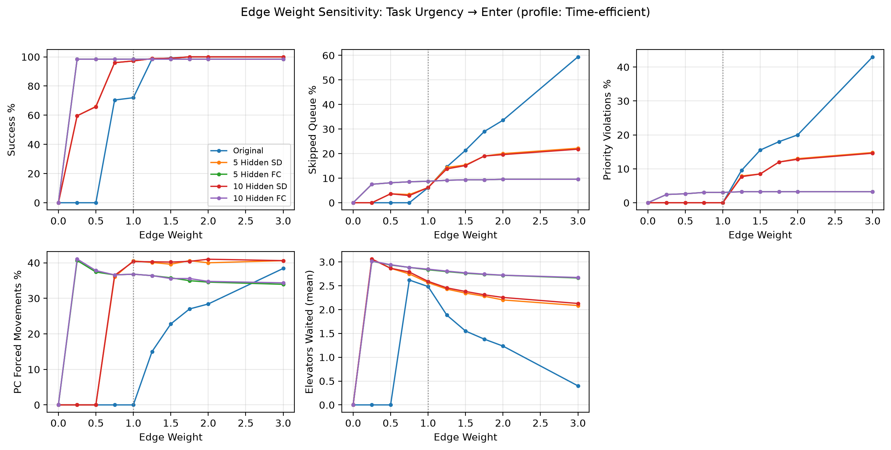

Code for the paper: Learning Gradual Argumentation for Decision Making

# Results sensitivity

## Edge Sensitivity Plots

Here are the edge sensitivity plots:

**First plot: Sensitivity of the Task Urgency → Enter edge weight.**

The Passenger Comfort → Enter and Queue Compliance → Enter edge weights are fixed at 1. The plot shows the evolution of the metrics across all robot profiles and for all the tested framework structures.

We can observe that the fully connected hidden-layer models (5 Hidden FC and 10 Hidden FC) exhibit similar behaviour for all non-zero edge weights, with very little variation. The Original framework (in blue) is the most flexible of all, while the semi-dense models (5 Hidden SD and 10 Hidden SD) also demonstrate a relatively flexible behaviour.

As expected, increasing the Task Urgency → Enter edge weight gives greater importance to robot urgency (i.e., the timeout). Consequently, as the edge weight increases, the number of successful tasks also increases, while the number of elevators waited for decreases. However, social norms become less important, resulting in more queue skips, more priority violations, and more instances of people with disabilities being packed inside the elevator.

Additionally, the Time-efficient and Comfort-blind models achieve higher success rates at lower edge weights, as their baselines are designed to prioritise time over other social norms.

It is worth noting that reducing the edge weight for the Comfort-blind model to 0.5 can significantly reduce the number of cases in which a person with a disability is packed inside the elevator.

These results represent the sensitivity analysis only when the other edge weights are fixed at 1. Therefore, they should not be considered fully representative of the overall framework behaviour.


Below, find the plots for the individual robot profiles.

Comfort-blind:


Comfort-caring:


Socially compliant: 


Time-efficient:




# Execution

To execute the experimentation run:

```
python3 train.py
```


# Setup

## Submodule (Uncertainpy)

To clone it with the required submodules (Uncertainpy package) run:

```
git clone --recurse-submodules <https://github.com/<this project name>>
```

If you already cloned withouth cloning the submodule try:

```
git submodule update --init
```


If any issue when downloading the submodules. Run:

```
git submodule add git@github.com:nicopotyka/Uncertainpy.git
```

## Virtual environment

This code was tested on a virtual environment (venv) on python 3.11 (due to Uncertainpy requirements)


## Library adaptation

Important: the uncertainpy code (in local) was modified for this experimentation:

./Uncertainpy/src/gradual/BAG.py

`New file can be found in BAG.py in the root of this repo, it will work if you copy that file into the package`


./Uncertainpy/src/uncertainpy/gradual/semantics/modular/MLPBasedInfluence.py

'''
class MLPBasedInfluence:
    def __init__(self) -> None:
        pass

    def compute_strength(self, weight, aggregate):
        
        if aggregate == 0:
            return weight
        
        if 1-weight == 0:
            return 1
        elif weight == 0:
            return 0
        
        return 1/(1 + math.exp(- math.log(weight/(1-weight)) - aggregate))

    def __str__(self) -> str:
        return __class__.__name__ 
'''
