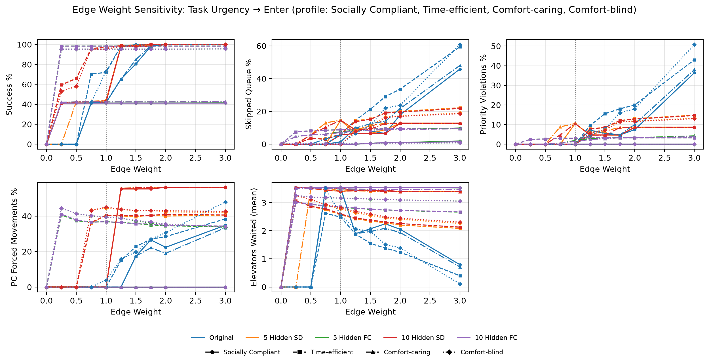
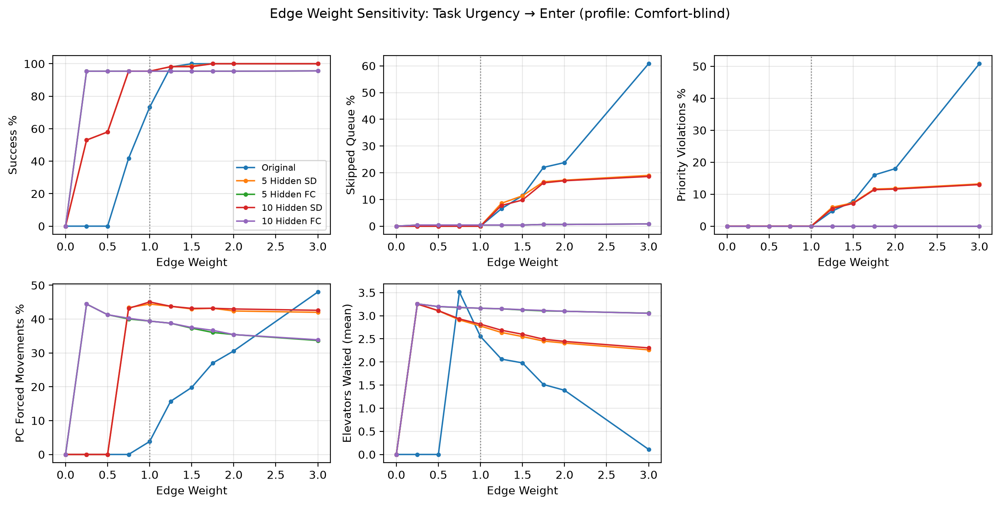
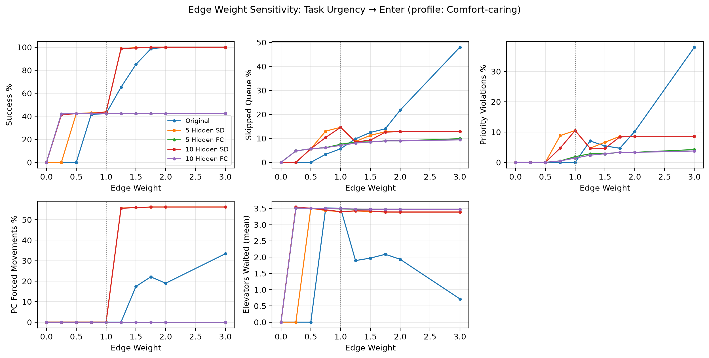
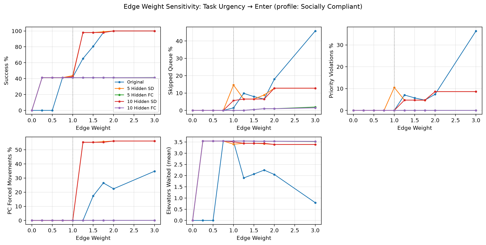

Code for the paper: Learning Gradual Argumentation for Decision Making

# Results sensitivity

## Edge Sensitivity Plots

Here are the edge sensitivity plots:

First plot: Sensitivity of the Task Urgency --> Enter edge weight. Fixing the Passenger Comfort --> Enter and Queue Compliance --> Enter edge weights to 1. The plot shows the evolution of the metrics for all robot profiles, and for all the tested framework structures. 

Observe that the Fully-connected hidden layers (5 Hidden FC, and 10 Hidden FC) achieve one behaviour when the edge weight is different from 0, and it barely changes. The Original framework (in blue) is the most flexible of all, with the semi-dense models (5 Hidden SD and 10 Hidden SD) achieving a flexible behaviour too. 

As expected, increasing the Task Urgency --> Enter edge weight gives more importance to the robot urgency (the timeout), therefore, as it increases, the number of successes also increases, the number of elevators waited decreases, and the social norms are less considered, resulting into more queue skips, more priority violations, and more people with a disability inside the elevator being packed. 



Below, find the plots for the individual robot profiles.

Comfort-blind:



Comfort-caring:



Socially compliant: 



Time-efficient:


# Execution

To execute the experimentation run:

```
python3 train.py
```


# Setup

## Submodule (Uncertainpy)

To clone it with the required submodules (Uncertainpy package) run:

```
git clone --recurse-submodules <https://github.com/<this project name>>
```

If you already cloned withouth cloning the submodule try:

```
git submodule update --init
```


If any issue when downloading the submodules. Run:

```
git submodule add git@github.com:nicopotyka/Uncertainpy.git
```

## Virtual environment

This code was tested on a virtual environment (venv) on python 3.11 (due to Uncertainpy requirements)


## Library adaptation

Important: the uncertainpy code (in local) was modified for this experimentation:

./Uncertainpy/src/gradual/BAG.py

`New file can be found in BAG.py in the root of this repo, it will work if you copy that file into the package`


./Uncertainpy/src/uncertainpy/gradual/semantics/modular/MLPBasedInfluence.py

'''
class MLPBasedInfluence:
    def __init__(self) -> None:
        pass

    def compute_strength(self, weight, aggregate):
        
        if aggregate == 0:
            return weight
        
        if 1-weight == 0:
            return 1
        elif weight == 0:
            return 0
        
        return 1/(1 + math.exp(- math.log(weight/(1-weight)) - aggregate))

    def __str__(self) -> str:
        return __class__.__name__ 
'''
